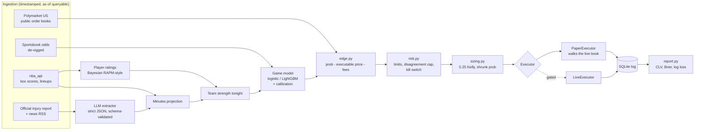

# edgebot

[](https://github.com/KKamx0/nba-prediction-market-system/actions/workflows/ci.yml)
[](https://github.com/KKamx0/nba-prediction-market-system/tree/python-coverage-comment-action-data)

An autonomous research agent for NBA moneyline markets on
[Polymarket US](https://docs.polymarket.us), the CFTC-regulated US exchange.
A statistical model sets every probability. The market price is treated as a
strong prior. The default action is **no bet**.

> **Status:** early development. Done so far: repo setup,
> [Phase 0 platform verification](docs/phase-0-verification.md), data
> ingestion ([data sources](docs/data.md)), player ratings and minutes
> projection, the game model with a walk-forward backtest and leakage test,
> the paper trading loop, reporting, LLM news extraction, and the gated live
> executor. Next: paper trading through the 2026-27 season
> ([runbook](docs/runbook.md)). Nothing here has traded real money.

## Why the LLM is kept away from the numbers

Recent benchmarks of LLM betting agents point the same way:

- **WC2026-Agents** ([arXiv:2607.17765](https://arxiv.org/abs/2607.17765)) ran
  four frontier models as forecasting agents on all 104 matches of the 2026
  World Cup, with the pre-match betting market as a fifth competitor. None of
  the agents beat the market's Brier score. Fading the market was unprofitable
  for all four, and a flat stake on the market favorite out-earned every agent.
- **KellyBench** ([arXiv:2604.27865](https://arxiv.org/abs/2604.27865)) simulated
  a full Premier League season with historical data and public odds. Every
  frontier model lost money on average, the best returned -8%, and several
  were ruined.

So edgebot uses the LLM for one narrow job: turning unstructured news into
structured availability fields. The LLM **never** outputs a probability, a
pick, or a bet size.

| Component | Produces | Never produces |
| - | - | - |
| Statistical model | calibrated win probability | — |
| LLM news extractor | `{player, team, status, minutes_impact_estimate, confidence, source_url, published_at}` | probabilities, picks, sizes |
| Market | executable price, strong prior | — |
| Risk engine | allow / block, size cap | — |

## Architecture



## Setup

**Step-by-step: [docs/runbook.md](docs/runbook.md)** (install → keys → load
history → backtest → `edgebot doctor` → run the loop through the season).

Requires Python 3.12+.

```bash
git clone https://github.com/KKamx0/nba-prediction-market-system.git
cd nba-prediction-market-system
python -m venv .venv && source .venv/bin/activate
pip install -e ".[dev]"
pre-commit install
cp .env.example .env   # fill in locally; never commit
pytest
```

Load data (see [docs/data.md](docs/data.md) for every source and its
availability rule):

```bash
edgebot init-db
edgebot ingest nba --season 2023-24 --season 2024-25 --season 2025-26
edgebot ingest schedule --season 2026-27
edgebot ingest injuries
edgebot snapshot markets
```

NBA stats endpoints block many datacenter IPs, so run ingestion from a home
connection.

## The LLM news layer

`news.py` sends RSS articles about teams playing soon to Claude
(`claude-opus-5-5`) with a JSON schema it must follow:

```json
{"player": "...", "team": "...", "status": "out|doubtful|questionable|probable|available|minutes_limit",
 "minutes_impact_estimate": -12, "confidence": 0.9, "source_url": "...", "published_at": "..."}
```

- The output can only change the **minutes projection**. It has no
  probability, pick, or size field, and the official injury report overrides
  it for any player the report lists.
- News is untrusted input. The article is fenced in tags and declared to be
  data. The output is schema-constrained and then re-validated locally;
  malformed output is rejected, not repaired. `source_url` and
  `published_at` come from the feed, never from the model. Players must be
  on the team's roster. The model has no tools. See [SECURITY.md](SECURITY.md).
- Extractions are stamped with when they became known, and the leakage test
  injects late "star is out" news to prove it can't leak into earlier
  decisions.
- Optional: without `ANTHROPIC_API_KEY` the loop runs on the official injury
  report alone.

## How team strength is built

1. **Player ratings** (`model/ratings.py`): offensive and defensive impact
   per 100 possessions from a ridge regression on game-level efficiency,
   weighted by each player's share of minutes. The ridge pulls toward last
   season's rating × 0.75, so the prior fades as current-season minutes
   accumulate. On synthetic leagues, one season recovers individual player
   value at ~0.5 correlation and team strength at > 0.85. Individual ratings
   are noisy; the team aggregate is what the model uses.
2. **Minutes** (`model/minutes.py`): a blend of last game, rolling averages
   and season average, trimmed on back-to-backs. Injury status sets a
   probability of playing, and freed minutes go to teammates in proportion to
   their role, capped at 42.
3. **Tonight's strength** (`model/strength.py`): Σ (minutes / 48) × net
   rating, computed for the expected lineup, the "every questionable player
   plays" and "every questionable player sits" cases, and full health.

## Paper mode

There is no Polymarket US sandbox, so paper mode is a local simulator. It
pulls the real order book from the public gateway at the moment of each order
and "fills" it by walking the book at our size, up to the limit price,
immediate-or-cancel, with the exchange's taker fee. No Polymarket account or
key is needed.

```bash
edgebot run --once          # one cycle, then exit
edgebot run --interval 300  # loop every 5 minutes
edgebot risk status         # bankroll, drawdown, exposure, breakers
edgebot kill                # kill switch: cancel orders and stop the loop
edgebot kill --clear
edgebot risk reset --confirm  # the only way out of a drawdown shutdown
```

Each cycle settles finished games and pulls new injury reports. It then
snapshots every book within 36 hours of tip (these snapshots measure closing
line value) and re-evaluates games 6h to 10min before tip. A game is
re-evaluated when first seen, after any new injury report, or every 30
minutes. Every decision is written to SQLite with its reasons, passes
included. With no sportsbook line available the model has no market prior,
so it passes instead of guessing.

**Per-game decision** (`trading/decision.py`):
1. If model and market disagree by more than 15 points, don't bet; flag for
   review.
2. The best side must clear a 4% edge over the executable price, after fees
   and slippage.
3. If anyone is questionable, the edge must hold in both the
   "everyone plays" and "everyone sits" scenarios.
4. Enough liquidity at prices that keep the edge.
5. 0.25 Kelly on a probability blended 50/50 with the market, then shrink
   the order until the edge still clears 4% at that size.

## Risk controls

These are enforced in code (`risk.py`), not left to configuration:

- Minimum edge of 4% **after** fees and slippage, plus a minimum liquidity.
- Disagreement cap: if the model and the market differ by more than 15 points,
  no bet. The game is flagged for review, since this usually means stale data
  or a missed injury.
- Sizing: 0.25 Kelly on a probability shrunk toward the market.
- At most 2% of bankroll per position and 10% total open exposure per night.
- At most one correlated position per game. No averaging down, no chasing.
- Daily loss limit of 5%, which halts trading until the next day.
- A 20% drawdown from peak triggers full shutdown; only a manual restart resumes.
- Kill switch (CLI command or flag file) that cancels open orders and stops the loop.

**Paper → live gate** (`gate.py`). `edgebot run --live --confirm-live`
refuses to start unless every check passes, computed from the database with
the same code as the report:

| Check | Requirement |
| - | - |
| Paper bets this season | ≥ 300 settled, over ≥ 6 weeks |
| Closing line value | mean > 0 and the 95% CI excludes zero |
| Calibration | model log loss < market-only baseline |
| ROI after fees | > 0 |
| Max paper drawdown | < 15% |
| Operator switches | `LIVE_TRADING=true`, `JURISDICTION_CLEARED=true`, `--confirm-live` |
| Bankroll | `LIVE_BANKROLL_CAP` > 0; live sizing uses min(cap, account buying power) |

Live orders (`trading/live.py`) are limit orders, immediate-or-cancel, with
`manualOrderIndicator = MANUAL_ORDER_INDICATOR_AUTOMATIC`, and each is
previewed with the exchange before it's sent. Short-side (NO) orders stay
off (`LIVE_ALLOW_SHORT=false`) until you confirm the short-side price
convention with a one-contract preview, because the docs don't specify it.
An order whose outcome is unknown, such as a timeout, is never retried; it
counts as exposure until reconciled. Paper and live keep separate risk
state.

## Backtest

```bash
edgebot backtest --validate 2023-24 --validate 2024-25 --test 2025-26
edgebot train   # fit the selected model on all data for live use
```

- **Strict walk-forward by date.** Models are refit every 30 days on games
  dated before the block they predict. Features are built as of 7pm ET on
  game day, and games that tip earlier are skipped.
- **Models:** the market-only baseline (calibrated sportsbook probability),
  logistic regression, and LightGBM with the market as an offset, so the
  trees can only learn corrections to it. Each is Platt- or
  isotonic-calibrated on the newest 20% of its training window.
- **Selection by log loss on validation seasons only.** Test seasons are
  reported, never tuned on. Brier score and ECE are reported too; accuracy
  is shown for context only.
- **Leakage test (CI).** For games across a season, every row known after
  the decision time is corrupted (results, box scores, late injury reports,
  late odds), and the feature vector must not change. A deliberately leaky
  feature proves the check has teeth, and a label-shuffle test confirms
  skill collapses without real outcomes.

**Results on real data: not yet run.** It needs NBA box scores and free
archived closing lines loaded from a home connection (see
[docs/data.md](docs/data.md)). The report and calibration plot land in
[`docs/backtest/`](docs/backtest/).

What synthetic tests already show: when the market is about as informed as
a real sportsbook, the feature models shave little or nothing off its log
loss, and the selector sometimes picks the market itself. The report then
says plainly that no feature model beat the baseline. Expect the same on
real data.

## Results so far

_No paper trading yet._ `edgebot report --export docs/results.md` writes
[`docs/results.md`](docs/results.md): bets and passes, closing line value
with a 95% CI, ROI after fees, model vs sportsbook log loss and Brier, max
drawdown, and a live calibration plot. It contains aggregates only, with no
account details or per-bet prices. `edgebot report --send` posts the same
summary to a Discord webhook, and the loop sends it daily when
`DISCORD_WEBHOOK_URL` is set.

Closing line value is the primary metric. ROI over a small sample is mostly
noise.

## Disclaimer

This is a personal research project, not financial advice. The legality of
prediction markets varies by state and is being litigated. See
[Phase 0](docs/phase-0-verification.md) for the situation in Washington. Check
the rules where you live before trading.
