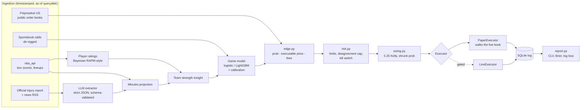

# edgebot

[](https://github.com/KKamx0/nba-prediction-market-system/actions/workflows/ci.yml)
[](https://github.com/KKamx0/nba-prediction-market-system/tree/python-coverage-comment-action-data)

An autonomous research agent for NBA moneyline markets on
[Polymarket US](https://docs.polymarket.us), the CFTC-regulated US exchange.
A statistical model sets every probability. The market price is treated as a
strong prior. The default action is **no bet**.

> **Status:** early development. Done so far: repo setup,
> [Phase 0 platform verification](docs/phase-0-verification.md), and data
> ingestion ([data sources](docs/data.md)). The model and trading layers are
> next. Nothing here has traded real money.

## Why the LLM is kept away from the numbers

Recent benchmarks of LLM betting agents point the same way:

- **WC2026-Agents** ([arXiv:2607.17765](https://arxiv.org/abs/2607.17765)) ran
  four frontier models as forecasting agents on all 104 matches of the 2026
  World Cup, with the pre-match betting market as a fifth competitor. None of
  the agents beat the market's Brier score. Fading the market was unprofitable
  for all four, and a flat stake on the market favorite out-earned every agent.
- **KellyBench** ([arXiv:2604.27865](https://arxiv.org/abs/2604.27865)) simulated
  a full Premier League season with historical data and public odds. Every
  frontier model lost money on average, the best returned -8%, and several
  were ruined.

So edgebot uses the LLM for one narrow job: turning unstructured news into
structured availability fields. The LLM **never** outputs a probability, a
pick, or a bet size.

| Component | Produces | Never produces |
| - | - | - |
| Statistical model | calibrated win probability | — |
| LLM news extractor | `{player, team, status, minutes_impact_estimate, confidence, source_url, published_at}` | probabilities, picks, sizes |
| Market | executable price, strong prior | — |
| Risk engine | allow / block, size cap | — |

## Architecture



## Setup

Requires Python 3.12+.

```bash
git clone https://github.com/KKamx0/nba-prediction-market-system.git
cd nba-prediction-market-system
python -m venv .venv && source .venv/bin/activate
pip install -e ".[dev]"
pre-commit install
cp .env.example .env   # fill in locally; never commit
pytest
```

Load data (see [docs/data.md](docs/data.md) for every source and its
availability rule):

```bash
edgebot init-db
edgebot ingest nba --season 2023-24 --season 2024-25 --season 2025-26
edgebot ingest schedule --season 2026-27
edgebot ingest injuries
edgebot snapshot markets
```

NBA stats endpoints block many datacenter IPs, so run ingestion from a home
connection.

## Paper mode

There is no Polymarket US sandbox, so paper mode is a local simulator. It pulls
the real order book from the public gateway and "fills" each order by walking
the book at our size, including taker fees. No account or API key is needed.
Paper mode is the default. Live trading is behind the gate described below.

## Risk controls

These are enforced in code (`risk.py`), not left to configuration:

- Minimum edge of 4% **after** fees and slippage, plus a minimum liquidity.
- Disagreement cap: if the model and the market differ by more than 15 points,
  no bet. The game is flagged for review, since this usually means stale data
  or a missed injury.
- Sizing: 0.25 Kelly on a probability shrunk toward the market.
- At most 2% of bankroll per position and 10% total open exposure per night.
- At most one correlated position per game. No averaging down, no chasing.
- Daily loss limit of 5%, which halts trading until the next day.
- A 20% drawdown from peak triggers full shutdown; only a manual restart resumes.
- Kill switch (CLI command or flag file) that cancels open orders and stops the loop.

**Paper → live gate.** `LiveExecutor` refuses to start unless the database
shows at least 300 paper bets over at least 6 weeks, positive average CLV with
a confidence interval excluding zero, model log loss better than the
market-only baseline, positive ROI after fees, and max drawdown under 15%.
It also requires `LIVE_TRADING=true`, `JURISDICTION_CLEARED=true`, and the
`--confirm-live` flag.

## Backtest results

_Not yet run._ The backtest will be a strict walk-forward by date across
multiple seasons, reported per season, and always compared with a
market-only baseline. If the model can't beat that baseline on log loss, this
section will say so.

## Results so far

_No paper trading yet._ This section is generated from `report.py` into
[`docs/results.md`](docs/results.md). Closing line value is the primary
metric; ROI over a small sample is mostly noise.

## Disclaimer

This is a personal research project, not financial advice. The legality of
prediction markets varies by state and is being litigated. See
[Phase 0](docs/phase-0-verification.md) for the situation in Washington. Check
the rules where you live before trading.
